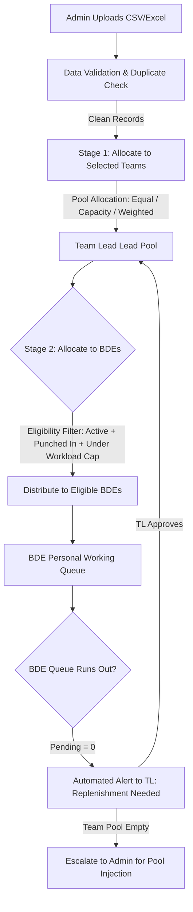
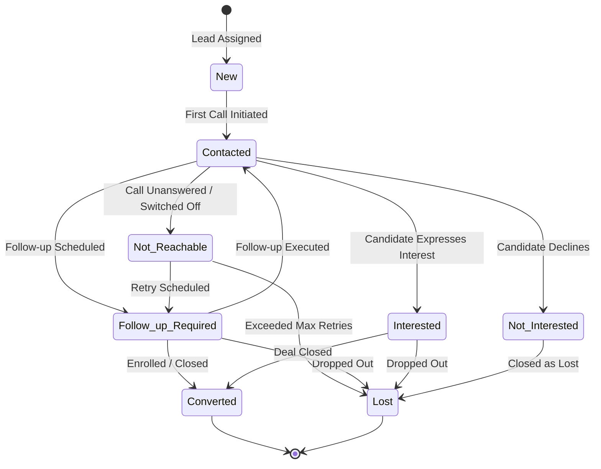
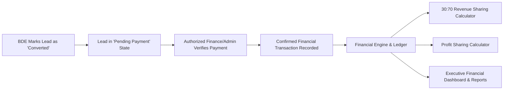

# Enabler – Hierarchical BDE Lead Management & Intelligent Data Allocation Platform

Enabler is an enterprise-grade hierarchical lead management, intelligent allocation, attendance tracking, and financial analytics platform. It orchestrates lead distribution from top-level administration down to operational Business Development Executives (BDEs), while maintaining strict role-based access control (RBAC), comprehensive audit trails, and integrated financial performance calculations.

---

## 1. System Architecture & Hierarchy

The application enforces a strict three-tier hierarchy at both the backend service layer and database query levels:

```
                  ┌──────────────────────┐
                  │      SUPER ADMIN     │
                  │ (Org-wide Governance)│
                  └──────────┬───────────┘
                             │
            ┌────────────────┴────────────────┐
            ▼                                 ▼
   ┌─────────────────┐               ┌─────────────────┐
   │   TEAM LEAD A   │               │   TEAM LEAD B   │
   │  (Team Alpha)   │               │   (Team Beta)   │
   └────────┬────────┘               └────────┬────────┘
            │                                 │
     ┌──────┴──────┐                   ┌──────┴──────┐
     ▼             ▼                   ▼             ▼
┌─────────┐   ┌─────────┐         ┌─────────┐   ┌─────────┐
│  BDE 1  │   │  BDE 2  │         │  BDE 3  │   │  BDE 4  │
└─────────┘   └─────────┘         └─────────┘   └─────────┘
```

### Role Matrix & Responsibilities

| Capability / Resource | Admin | Team Lead (TL) | BDE |
| :--- | :---: | :---: | :---: |
| **Manage Users & Teams** | Full (CRUD, Deactivate, Reassign) | View Assigned Team Members | Self Profile Only |
| **Data Ingestion (CSV/Excel)** | Full Ingestion & Deduplication | ❌ None | ❌ None |
| **Stage 1 Allocation** | Admin ➔ Team Pools | ❌ None | ❌ None |
| **Stage 2 Allocation** | Override / Configure rules | Team Pool ➔ Team BDEs | ❌ None |
| **Calling & Status Updates** | Audit / Monitor View | Team Monitoring & Escalation | Assigned Leads Execution |
| **Follow-up Scheduling** | Full Visibility | Team Overdue & Queue Tracker | Personal Follow-up Calendar |
| **Attendance** | Org-wide Review & Adjustment | Team Punch Records Review | Punch In / Punch Out |
| **Performance Analytics** | Organization & Team Comparisons | Team & BDE Comparative Metrics | Individual KPIs & Conversion |
| **Financial Management Module** | Revenue/Profit Calculators, Trans. Logs | ❌ Strict No-Access | ❌ Strict No-Access |
| **System Configuration** | Work Hours, Targets, Formulas, Ratios | ❌ Read-only limits | ❌ None |

---

## 2. Lead Allocation Engine & Distribution Logic

The lead allocation operates in two distinct stages with built-in deduplication and eligibility gates.



### Stage 1: Admin to Teams
1. **Deduplication Check**: Validates phone numbers, emails, and candidate IDs against existing active leads. Duplicates are flagged and isolated in an ingestion error report.
2. **Distribution Methods**:
   - **Equal Split**: Equal distribution across chosen active teams.
   - **Custom/Weighted**: Defined quotas per team based on team size or tier.

### Stage 2: Team Lead to BDEs
1. **Eligibility Criteria**:
   - BDE status = `ACTIVE` (not suspended, inactive, or offboarded).
   - BDE Attendance = `PUNCHED_IN` (for daily active real-time distribution).
   - Workload constraint: `current_pending_leads < max_bde_workload_limit`.
2. **Distribution Algorithms**:
   - **Round Robin / Equal**: Distributed incrementally across all eligible BDEs.
   - **Workload-Balancing**: Prioritizes BDEs with the lowest number of unprocessed leads.
   - **Manual Selection**: Team Lead manually selects batch sizes per BDE.

---

## 3. Lead Lifecycle & Interaction State Machine

Each lead moves through a rigorous state machine where each transition requires timestamp, actor ID, and mandatory remarks:



### Lead Exhaustion Workflow
- When a BDE's `Pending` lead count drops to `0`:
  1. BDE Dashboard displays an empty state banner with a request replenishment button.
  2. Team Lead dashboard receives an urgent notification indicator showing the BDE is idle.
  3. If Team pool has available leads, the TL can trigger instant batch distribution.
  4. If Team pool is exhausted, the system flags the team on the Admin dashboard for data injection.

### Inactivity, Absence, & Offboarding
- If a BDE is absent or deactivated:
  - System freezes incoming lead allocations for that user.
  - Team Lead or Admin can trigger **Batch Reassignment** for all un-converted and pending leads.
  - Full audit history of previous assignments is permanently recorded in `lead_assignment_history`.

---

## 4. Attendance & Working Hours Engine

- **Punch In / Punch Out**: Captures exact server UTC timestamps, client IP, and optional geo-coordinates.
- **Duration Calculation**: Net working hours calculated per day.
- **Rule Verification**:
  - `Late Arrival`: Punch In > `shift_start_time + grace_period_minutes`.
  - `Early Departure`: Punch Out < `shift_end_time - early_exit_grace_minutes`.
  - `Half Day`: Working hours between `half_day_threshold_hours` and `full_day_threshold_hours`.
  - `Missing Punch Out`: Auto-flagged at day end if status is still Punched In.
- **Audit Trails**: Attendance entries cannot be directly modified by BDEs. Any adjustment by Admin/TL creates a log entry specifying modifier ID, original value, revised value, and reason.

---

## 5. Performance Analytics & Metrics Formulas

All calculations use strict, auditable formulas configured via Admin Settings:

1. **BDE Conversion Percentage**:
   $$\text{BDE Conversion \%} = \left( \frac{\text{Successful Converted Leads}}{\text{Total Leads Assigned}} \right) \times 100$$
   *(Excludes leads reassigned away due to absence or invalid data)*

2. **Team Lead Conversion Percentage**:
   $$\text{Team Conversion \%} = \left( \frac{\sum \text{Team Successful Conversions}}{\text{Total Leads Received by Team}} \right) \times 100$$

3. **Organization Conversion Percentage**:
   $$\text{Overall Org Conversion \%} = \left( \frac{\text{Total Converted Leads}}{\text{Total Uploaded and Allocated Leads}} \right) \times 100$$

4. **Contact Rate & Velocity**:
   - $\text{Contact Rate} = (\text{Contacted Leads} / \text{Assigned Leads}) \times 100$
   - Average Turnaround Time (TAT) from assignment to first contact.

---

## 6. Financial Management & Revenue Sharing Module

The Financial Module is strictly isolated to Admin access and integrates directly with confirmed business conversions.



### 1. Revenue Sharing Engine (Default 30:70 Configurable)
- **Inputs**: Confirmed Gross Revenue ($R$).
- **Calculations**:
  - $\text{Company Share} = R \times \left(\frac{\text{Company \%}}{100}\right)$
  - $\text{Remaining Share} = R \times \left(\frac{\text{Remaining \%}}{100}\right)$
  - *Where $\text{Company \%} + \text{Remaining \%} = 100\%$ (Configurable by Admin)*

### 2. Profit Sharing Engine
- **Inputs**: Gross Revenue ($R$), Total Cost/Investment ($I$).
- **Calculations**:
  - $\text{Net Profit} = R - I$
  - If $\text{Net Profit} > 0$:
    - $\text{Company Profit Share} = \text{Net Profit} \times \left(\frac{\text{Profit Share \%}}{100}\right)$
    - $\text{Remaining Profit Share} = \text{Net Profit} \times \left(\frac{100 - \text{Profit Share \%}}{100}\right)$

### 3. Additional Financial Utilities
- Custom percentage calculation.
- Discount amount & net realization pricing.
- Percentage increase / decrease and sales growth tracking.
- Every manual calculation is saved in `financial_calculation_history` with inputs, outputs, timestamp, and operator ID.

---

## 7. Database Entity Relationship Overview

The core entity relationships:

- `users` (id, role: ADMIN | TEAM_LEAD | BDE, team_id, status: ACTIVE | INACTIVE)
- `teams` (id, name, team_lead_id, status)
- `leads` (id, name, phone, email, current_team_id, current_bde_id, status, created_at)
- `lead_assignment_history` (id, lead_id, assigned_by, assigned_to_team, assigned_to_bde, assigned_at, reason)
- `lead_status_history` (id, lead_id, changed_by, old_status, new_status, remarks, timestamp)
- `follow_ups` (id, lead_id, bde_id, scheduled_time, status: PENDING | COMPLETED | MISSED, remarks)
- `attendance` (id, user_id, date, punch_in, punch_out, duration_minutes, status: PRESENT | HALF_DAY | LATE | ABSENT, audit_trail)
- `financial_transactions` (id, lead_id, gross_amount, net_profit, company_share, remaining_share, confirmed_by, confirmed_at, status)
- `financial_calculations` (id, calc_type, input_values, result_values, created_by, created_at)
- `system_settings` (id, setting_key, setting_value, category, updated_by, updated_at)

---

## 8. Development Roadmap

1. **Phase 1: Foundation & Data Modeling** - DB Schema, Migrations, RBAC Middleware, Authentication.
2. **Phase 2: Ingestion & 2-Tier Lead Allocation Engine** - Bulk upload, deduplication, team pooling, BDE workload balancing.
3. **Phase 3: BDE Execution & Follow-up Workflow** - Calling workbench, status state transitions, remarks history, follow-up scheduler & notifications.
4. **Phase 4: Attendance Tracking & Admin Configuration** - Punch in/out, grace period rules, administrative overrides with audit logs.
5. **Phase 5: Performance Analytics & Reporting** - BDE, Team, and Org dashboards, KPI cards, Excel/CSV export.
6. **Phase 6: Financial Management Module** - Revenue/Profit sharing engines, transaction confirmation, financial ledger, and analytics.
